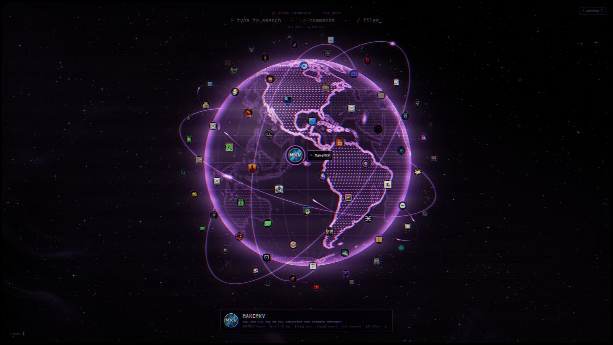
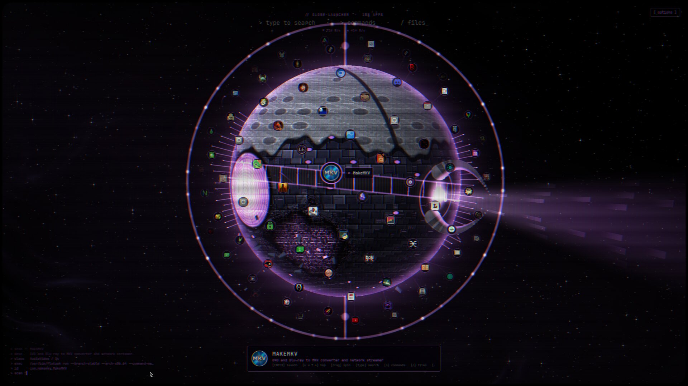
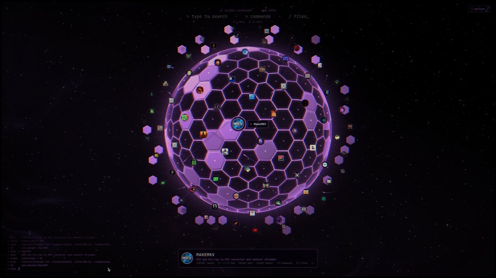
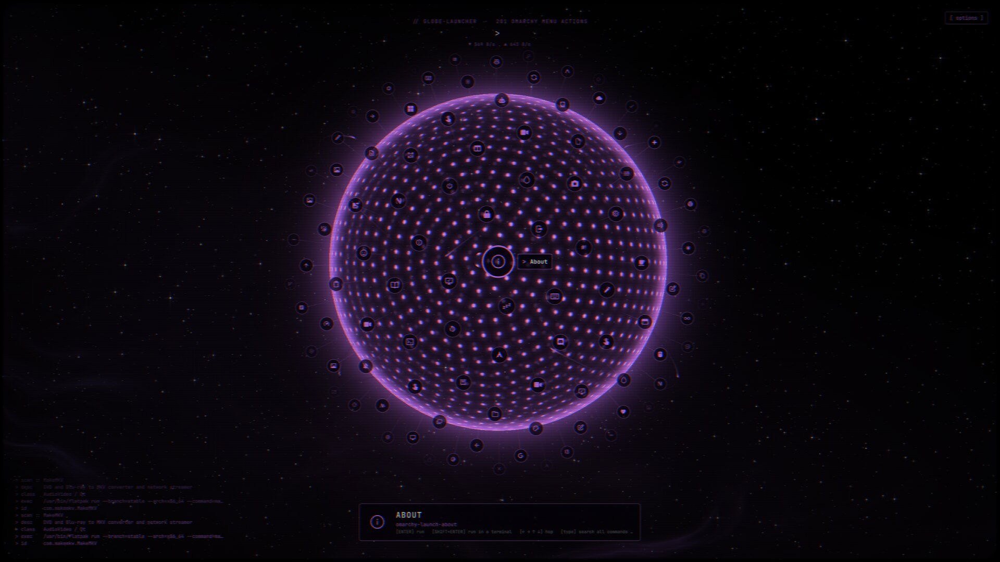
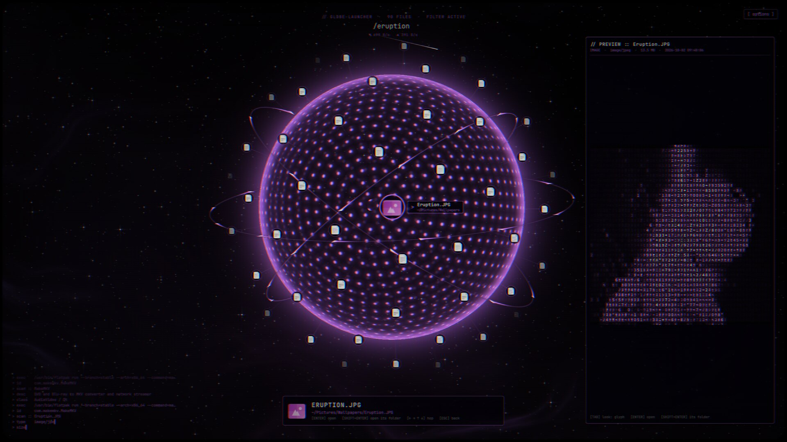
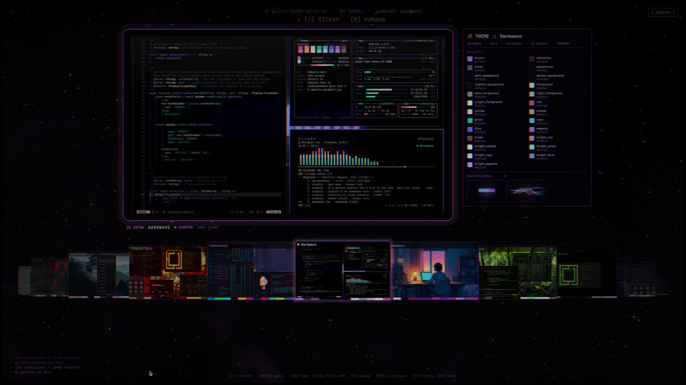
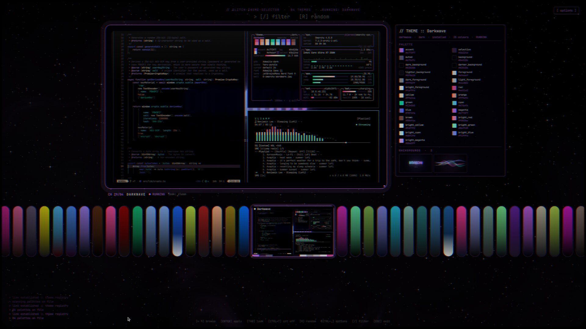
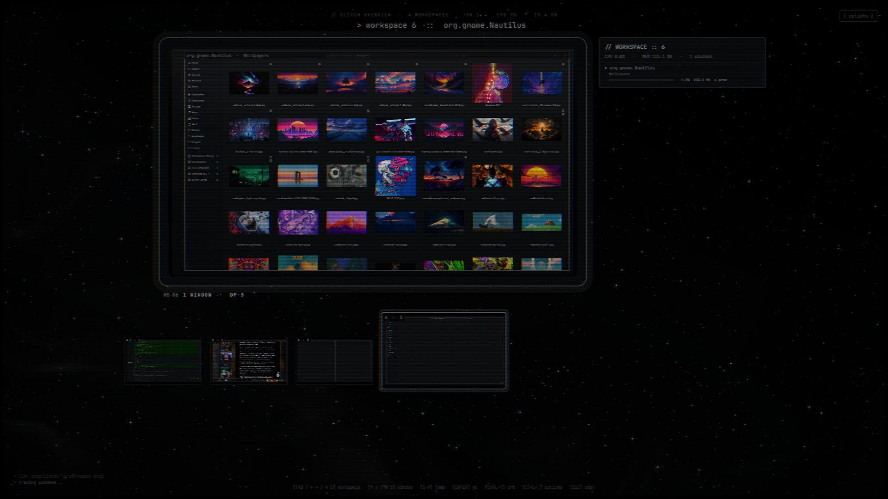
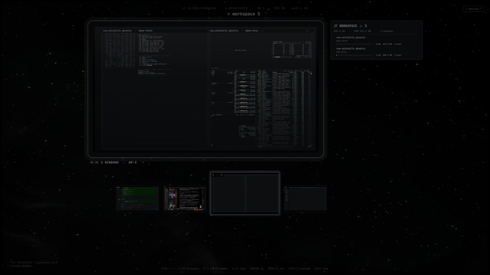

# Glitch-Launcher-Collection

Four Omarchy shell plugins with one look - old CRT monitors, matrix code,
starfields and nebulae, screens that glitch in over your desktop and back
out again:

| Component | Folder | What it is | Key (with `--keys`) |
| --- | --- | --- | --- |
| **Glitch-Globe-Launcher** | [`glitch-globe-launcher`](glitch-globe-launcher) | an app launcher: your apps projected out from a spinning globe; `>` Omarchy commands, `/` files with previews | Super + Space |
| **Glitch-Theme-Selector** | [`glitch-theme-selector`](glitch-theme-selector) | every Omarchy theme on a CRT, its palette and backgrounds read out; Enter applies | Super + Shift + Ctrl + Space |
| **Glitch-Background-Selector** | [`glitch-background-selector`](glitch-background-selector) | the theme's wallpapers, then your own folder; fit modes; Enter sets | Super + Ctrl + Space |
| **Glitch-Overview** | [`glitch-overview`](glitch-overview) | Alt+Tab for workspaces: every window live on a CRT, each one's CPU and memory scrawled beside it; let go of Alt to go | Alt + Tab |

Each folder is a complete plugin with its own README.

## Screenshots

**Glitch-Globe-Launcher** - three of its globe styles (Holo Earth, Unicron,
Bestagon), the Omarchy menu's actions after `>`, and a file previewed in
the glyph look after `/`:



| | |
| --- | --- |
|  |  |
|  |  |

**Glitch-Theme-Selector** - the arc and the pills carousels, the whole UI
in the highlighted theme's colours:

| | |
| --- | --- |
|  |  |

**Glitch-Background-Selector** - your own folder's wallpapers on the hand
carousel, the monitor previewing blur fit:


**Glitch-Overview** - Alt+Tab across workspaces: each one live on the
monitor, what its windows cost (CPU, memory, processes) beside it:

| | |
| --- | --- |
|  |  |

## Install

Clone it, then install all three or any of them:

```sh
git clone https://github.com/DasPoxy/Glitch-Launcher-Collection.git
cd Glitch-Launcher-Collection

./install.sh all              # everything
./install.sh theme            # just one
./install.sh globe overview   # or a few
./install.sh all --keys       # ...and bind their keys too
```

`install.sh` copies each one into `~/.config/omarchy/plugins/<id>` and
enables it. With `--keys` it also adds its key to
`~/.config/hypr/bindings.lua` (backed up first), taking it over from the
Omarchy default listed above (the Omarchy menu moves to Super + Ctrl + Alt +
Space when the launcher takes Super + Space). Without it, bind them yourself:

```lua
o.bind("SUPER + SPACE", "Glitch-Globe-Launcher", "omarchy-shell shell toggle glitch-globe-launcher '{}'")
```

Then:

```sh
./install.sh update           # pull the latest, refresh what's installed
./install.sh remove theme     # take one out (or: remove all)
./install.sh list             # what's installed
```

Needs `rsync` and `jq`; the selectors and the overview use Python 3 (the selectors with Pillow), the launcher
also `fd` and `fzf` for its file search.

## License

MIT
