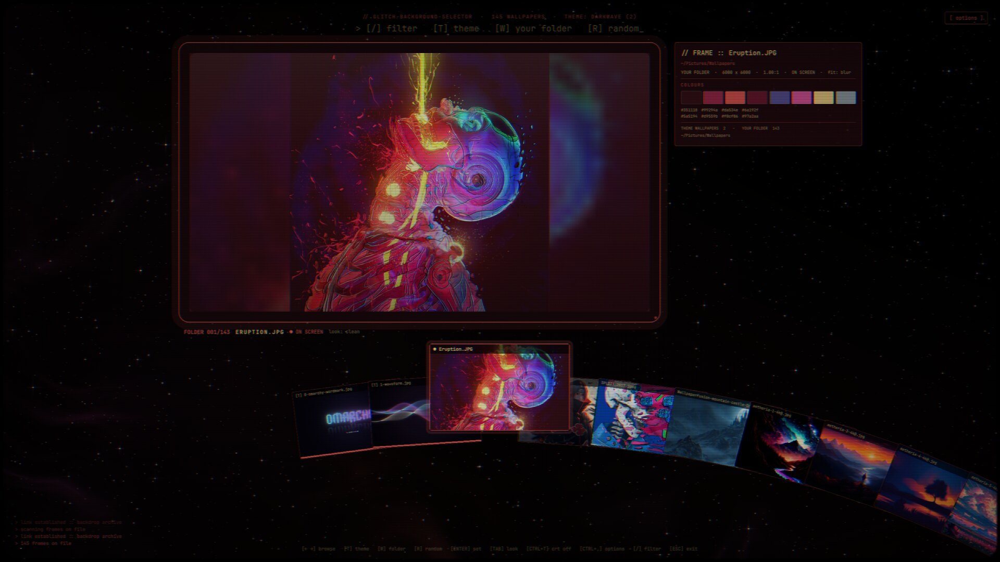

# Glitch-Background-Selector



An Omarchy wallpaper selector with an old-monitor, glitchy matrix / cyberpunk
feel - a sibling of [Glitch-Theme-Selector](../glitch-theme-selector)
and [Glitch-Globe-Launcher](../glitch-globe-launcher).

- **Your wallpapers, the theme's first**: the current theme's wallpapers
  (yours for it in `~/.config/omarchy/backgrounds/<theme>`, then its own)
  come first, together, marked with a bar; then every image in your
  wallpapers folder (set in the options, a few levels deep). **T** jumps to
  the start of the theme's, **W** to your folder's, **R** to a random one
  (**Shift+R** sets a random one straight away).
- **The monitor**: the highlighted wallpaper on a glowing CRT set,
  materialising as you move to it - plain, or through a grid, glyph or code
  rain look (Tab).
- **The readout**: its name, folder, section, size and shape, and its
  colours (the eight that stand out, most common first).
- **The whole UI wears the highlighted wallpaper's colours**, easing across
  as you browse.
- **The carousel**: arc, line, hand, ring, panorama, triple, grid, pills or
  blips (options). Arrows, the wheel or a click browse; **/** filters.
- **Set it**: Enter (or a click on the highlighted card) runs
  `omarchy theme bg set` - with a hard glitch - and the selector stays open.
- **The feel**: CRT scanlines and phosphor mask (Ctrl+T), the screen acting
  up now and then, a light glitch as you browse, and glitching in over your
  desktop and back out to it.

**Options** (Ctrl+, or the button top right): the wallpapers folder, how
the wallpaper fits the screen (fill, fit, blur fit, stretch, center, tile -
anything but fill is rendered at the screen's size by `render-bg.py`, since
the shell always crops to fill), the carousel style, the monitor's look, CRT on / off, glitches normal / subtle /
off, the open / close glitch, and whether setting a wallpaper leaves it open
or glitches out to the desktop. Kept in
`~/.config/glitch-background-selector/settings.json`.

## Install

Part of [Glitch-Launcher-Collection](../README.md): from a clone of it,

```sh
./install.sh background           # add --keys to bind its key too
```

Open it with `omarchy-shell shell toggle glitch-background-selector '{}'`.

## How it works

`backgrounds.py` lists the wallpapers as JSON; `palette.py` reads one's size
and colours (cached in `~/.cache/glitch-background-selector`). The shaders
in `shaders/` are shared with Glitch-Theme-Selector and Globe-Launcher;
after editing one, recompile it with
`/usr/lib/qt6/bin/qsb --qt6 -o shaders/X.frag.qsb shaders/X.frag`.

## License

MIT
